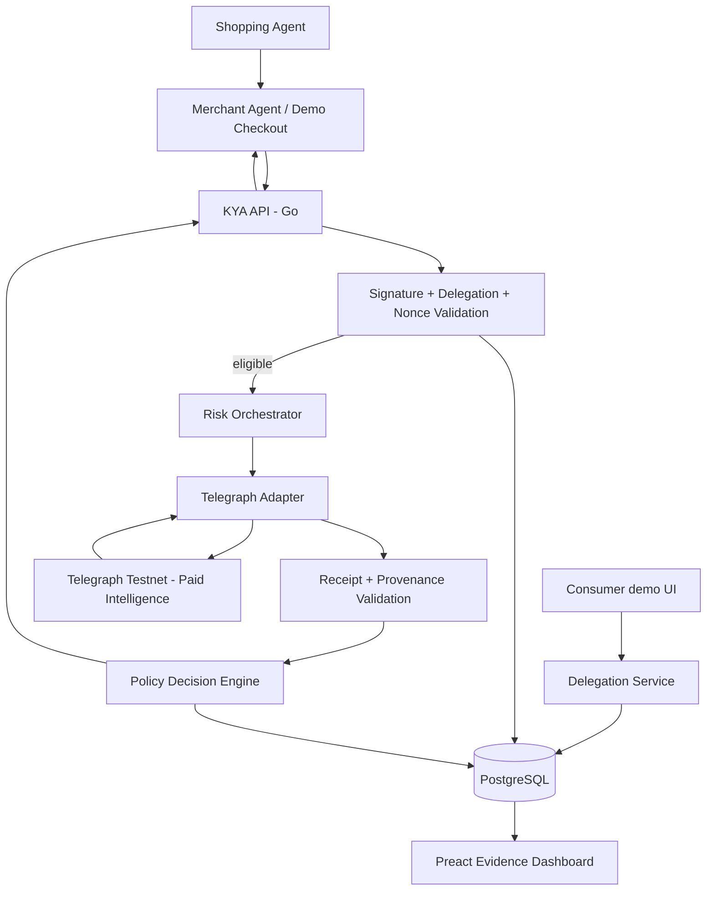

# Product Requirements Document — KYA Gateway: Telegraph Hackathon Edition

**Version:** 1.0  
**Prepared:** 23 October 2026  
**Status:** Build-ready proposal; protocol API details require confirmation against live documentation  
**Track:** Telegraph Hackathon Season II — Apps & Agents  
**Primary mission:** 07 Consumer Platform  
**Secondary mission (stretch):** 09 Personal Agent  
**Competition:** 1 November–1 December 2026; final submission 1 December 2026, 23:59 UTC

## 1. Executive summary

KYA Gateway is a merchant-side trust and authorization service for autonomous commerce. It allows a merchant agent to verify that a shopping agent controls a registered signing key, carries a valid and narrowly scoped consumer delegation, and is acting within the transaction's spending policy. For additional risk context, KYA autonomously **purchases intelligence through Telegraph**, validates the resulting response and receipt, and issues an explainable `ALLOW`, `REVIEW`, or `DENY` decision.

**Hackathon demonstration:** A consumer authorizes an AI shopping agent to purchase a $350 item under a $500 limit. The shopping agent submits a signed purchase intent to a merchant agent. The merchant calls KYA. KYA checks identity, delegation and replay protection locally, then buys a risk assessment via a supported Telegraph intent. KYA makes an authorization recommendation using the returned intelligence, displays Telegraph request/receipt evidence, and allows the merchant to complete a **simulated** checkout. The demo also shows over-limit, revoked, invalid-signature and high-risk cases.

**Product promise:** *Know who the agent is, what it is authorized to do, and why the merchant should or should not accept its transaction.*

**Critical separation:** Cryptographic identity proves key control, not the customer's real-world identity, payment authorization or safety. Telegraph's intelligence result is an input to risk decisioning, not proof of customer consent. KYA does not replace banks, card-network authentication, SCA or payment processor obligations.

## 2. Hackathon fit and verified rules

- The primary mission is **Consumer Platform**, whose examples include marketplace agents verifying one another before money moves.
- The submission is in **Apps & Agents**: the application must make at least one genuine autonomous machine-to-machine purchase/sale using a supported Telegraph flow and use the purchased intelligence to perform a meaningful task. Supported testnet implementations can qualify.
- **14 November 2026:** first integration progress checkpoint. Demonstrate a working request/purchase, an attempt or a blocker; this is **not** a disqualification deadline.
- **1 December 2026, 23:59 UTC:** main competition submission deadline.
- Official judging weights: technical quality/mainnet readiness **35**, commercial viability **30**, independent adoption/retention **15**, quality of Telegraph integration **10**, proof/demo/reproducibility **10**. Minimum **70/100** overall and **24/35** technical, plus a working Telegraph purchase.
- Submission: reviewer-access URL, 2–5 minute video, run instructions, actual network and cost disclosures, real transaction/receipt evidence, short public and commercial summaries.
- Pre-event code may be reused and disclosed, but H2-specific transaction evidence must be from the event period.

**Sources:**
- https://hackathon.telegraphprotocol.com/rules
- https://hackathon.telegraphprotocol.com/missions
- https://hackathon.telegraphprotocol.com/
- https://telegraphprotocol.com/

**Verification note:** Telegraph interfaces, exact supported intent IDs, credential mechanisms, payment APIs and receipt fields must be confirmed in current developer docs during integration. Examples below are **KYA-owned API contracts**, not claims about Telegraph's exact endpoint names.

## 3. Problem and users

### Problem

Merchants can see automated traffic, but often cannot tell a customer-authorized shopping agent from abusive automation. Agent identity alone is insufficient: a genuine agent can still exceed its budget, act after consent expires, replay an old request, or execute a risky transaction. Merchant teams need a machine-readable decision supported by both cryptographic authorization and independent risk evidence.

### Primary personas

| Persona | Job to be done | Hackathon interaction |
|---|---|---|
| Merchant / merchant agent | Decide whether to accept an agent-initiated checkout | Calls `/v1/verify-transactions` |
| Shopping agent developer | Present signed identity and purchase intent | Uses lightweight TypeScript client |
| Consumer | Bound an agent's purchasing authority | Creates short-lived delegation in demo UI |
| Merchant risk analyst / judge | Inspect the reason and provenance for decisions | Uses Preact dashboard and receipt links |

### Buyer hypothesis

Merchant platforms, marketplaces and agent-commerce gateways would pay for verification, authorization policy and risk decisioning. Pricing is a **hypothesis**, not proven willingness to pay. Initial commercial experiment: free developer tier plus per-verification metering for merchant pilots; Telegraph intelligence cost is a separately tracked variable cost.

## 4. Goals, non-goals and success metrics

### Must achieve

1. Verify Ed25519-signed agent requests against registered public keys.
2. Create and validate short-lived signed delegations with amount, currency, merchant, action, expiry and unique ID.
3. Block nonce replay, expired delegations, invalid signatures and over-limit purchases before external intelligence spending.
4. Autonomously purchase a relevant supported intelligence result through Telegraph for otherwise eligible transactions.
5. Validate and store provider/intent, request ID, receipt/transaction proof, price and result when provided by Telegraph.
6. Produce explainable `ALLOW`, `REVIEW` or `DENY` with stable reason codes.
7. Demonstrate a complete working merchant checkout with simulated merchandise payment and a **real** Telegraph testnet intelligence purchase.
8. Provide independently repeatable tests, a live reviewer-access demo and a concise runbook.

### Non-goals

- Real card payment, custody, KYC, SCA substitution or banking integrations.
- Universal cross-platform reputation scores or a global certificate authority.
- On-chain storage of consumer identities, prompts or delegation contents.
- Issuing credentials that purport to prove the consumer's legal identity.
- Shipping a Telegraph Miner/Evaluator in the core submission; optional future track.
- Deploying a custom blockchain or smart contracts merely for audit logging.

### Acceptance targets (engineering targets, not guaranteed results)

| Metric | Target |
|---|---|
| Successful genuine Telegraph purchases | >= 1 verified end-to-end, aim for >= 10 distinct test cases |
| Signed valid checkout | `ALLOW` if policy passes and risk evidence is acceptable |
| Over-limit / revoked / expired / replayed request | 100% `DENY` in automated tests |
| Telegraph outage | `REVIEW` or `DENY` under fail-closed configuration; never silently `ALLOW` |
| Reproducibility | Reviewer can run a new input and inspect a real receipt |
| Demo | 2–5 minutes, covers happy path and at least two failure paths |
| API tests | >= 80% coverage of critical authorization/decision logic |
| Secret leakage | Zero signing keys, wallet secrets or sensitive user data in public logs |

## 5. Demo narrative and core workflows

### Demo A — Allowed purchase

1. Consumer creates a delegation: `purchase`, merchant `demo-merchant`, USD, maximum $500, expires in 30 minutes.
2. Shopping agent signs a canonical $350 purchase intent with a new nonce and delegation reference.
3. Merchant agent submits the signed request to KYA.
4. KYA verifies identity, signature, delegation, merchant, budget, expiry, and nonce.
5. KYA autonomously requests paid transaction/fraud risk intelligence from Telegraph using the currently supported intent and payment flow.
6. KYA verifies response provenance and receipt metadata available from the integration; applies the policy engine.
7. Merchant sees `ALLOW` with a readable explanation, risk evidence, price, request identifier and transaction/receipt link.
8. Simulated checkout completes; audit trail records decision and evidence hashes.

### Demo B — Over-budget purchase

Same agent requests $650. KYA returns `DENY` / `AMOUNT_EXCEEDS_DELEGATION`. No Telegraph purchase is made; no unnecessary intelligence cost incurred.

### Demo C — High-risk purchase

Valid $350 signed request, but the purchased Telegraph risk intelligence exceeds the configured threshold or indicates high risk. KYA returns `REVIEW` or `DENY` with an explicit reason and evidence.

### Demo D — Revocation / replay

Consumer revokes delegation or repeats an old nonce. KYA denies immediately, before calling Telegraph.

### Demo E — Provider unavailable

Telegraph request times out, receipt verification fails, or no suitable supported intent is available. KYA does not fabricate a result; the decision is `REVIEW` / `RISK_INTELLIGENCE_UNAVAILABLE` (or `DENY` under strict merchant policy). UI clearly labels simulated risk results if a local-only mode is shown.

## 6. Functional requirements

### FR-01 Agent registration (P0)

- Create agent record: `agent_id`, developer label, public key, status, created timestamp.
- Require proof of possession: server-issued challenge signed by agent private key.
- Support key rotation and disabling an agent.
- Do not imply external identity verification absent a separate proofing flow.

### FR-02 Delegated authority (P0)

- Create signed delegation from an authenticated demo consumer identity.
- Required claims: `delegation_id`, `subject_agent_id`, `merchant_id`, `actions`, `max_amount_minor`, `currency`, `issued_at`, `expires_at`, `issuer`, `audience`.
- Optional: product category, SKU allowlist, per-transaction and cumulative limits.
- Enforce merchant scope and expiry; support revocation.
- For demo, consumer authentication may be a local test account. State that it is not production identity proofing.

### FR-03 Signed purchase intent (P0)

- Required fields: agent ID, merchant ID, amount in integer minor units, currency, cart digest, delegation ID, timestamp, nonce and signature.
- Deterministic canonicalization; reject malformed or non-canonical payloads.
- Enforce maximum clock skew and atomic nonce uniqueness.
- Hash and log intent without exposing customer PII.

### FR-04 Policy engine (P0)

- Evaluate signature, delegation status, merchant, action, amount, currency, nonce and expiry **before** purchasing intelligence.
- Rules are deterministic and versioned.
- Return `ALLOW`, `REVIEW`, `DENY` plus stable reason codes and human-readable explanation.
- Risk score thresholds must be configurable and calibrated for the selected Telegraph intent. Do not assume a universal 0–100 risk score.

### FR-05 Telegraph intelligence client (P0)

- Discover and confirm a supported relevant intent (candidate families: transaction/fraud risk); record its exact ID, schema, network and version in `docs/telegraph-integration.md`.
- Implement the supported machine-to-machine paid request flow with credentials/wallet configured securely.
- Store observed request ID, provider/intent, response metadata, amount/currency, receipt ID, transaction hash and explorer URL **only if actually provided**.
- Distinguish `REQUESTED`, `SETTLED`, `FAILED`, `UNVERIFIED` evidence states.
- Verify settlement/receipt using official tooling or supported APIs, not only by trusting a string in an API response.
- Apply retry/backoff, timeout, idempotency and per-transaction spend cap; avoid duplicate paid calls.
- Reject mismatched intent schemas; never silently substitute mock intelligence in competition mode.

### FR-06 Decision and evidence (P0)

- Store policy version, signed intent hash, delegation reference, Telegraph evidence and decision reasons.
- Provide human-readable decision trace without secrets or personal identifiers.
- Clearly label testnet evidence and simulated merchant checkout.
- Produce append-only application audit records with a hash chain; this is **tamper-evident**, not a guarantee of immutability.

### FR-07 Merchant dashboard (P0)

- Demo checkout view: agent, item, price, consent scope and decision.
- Decision inspector: local authorization checks, purchased intelligence, cost and Telegraph receipt link.
- Scenarios: approved, over-limit, revoked, replay and unavailable.
- Reviewer-safe public mode with seeded synthetic identities and no live secrets.

### FR-08 Developer integration (P1)

- TypeScript agent/merchant client and copy-paste example.
- OpenAPI specification for KYA endpoints.
- Docker Compose and `.env.example`.

### FR-09 External adoption evidence (P1)

- Invite one independent developer to integrate the sample merchant or invoke verification with their own test agent.
- Collect opt-in, non-sensitive reproduction evidence and feedback. Do not misrepresent self-generated testnet transactions as independent customer adoption.

## 7. Proposed technical architecture



### Technology choices

| Component | Choice | Rationale |
|---|---|---|
| Backend | Go 1.25+ or stable supported version | Fast APIs, cryptography, typed integration |
| Dashboard | Preact + TypeScript + Vite | Lightweight demo UI |
| Database | PostgreSQL | Transactional nonce/delegation/audit state |
| Cache (optional) | Redis | Rate limits; not source of truth for nonce uniqueness |
| Crypto | Ed25519 + SHA-256; standard library / vetted libraries | Key possession and signed intent |
| API | REST + OpenAPI 3.1 | Easy merchant integration |
| Protocol adapter | Telegraph official SDK/API if supported | Avoid assumptions about network endpoints |
| Hosting | Docker Compose locally + hosted HTTPS API/UI | Reproducible judge setup |
| Monitoring | Structured JSON logs + metrics | Trace decisions and network cost |

**Boundary:** Telegraph ranks, routes and settles intelligence requests. KYA owns consumer delegation, merchant policy and transaction decisioning. Telegraph does not become the source of consent truth.

## 8. Data model

### `agents`
`id UUID PK`, `agent_id TEXT UNIQUE`, `developer_label TEXT`, `public_key BYTEA`, `key_version INT`, `status ENUM(active,disabled)`, `created_at TIMESTAMPTZ`.

### `delegations`
`id UUID PK`, `delegation_id TEXT UNIQUE`, `agent_id FK`, `merchant_id TEXT`, `allowed_actions JSONB`, `max_amount_minor BIGINT`, `currency CHAR(3)`, `issued_at`, `expires_at`, `revoked_at`, `signed_payload JSONB`, `signature BYTEA`.

### `purchase_intents`
`id UUID PK`, `intent_id TEXT UNIQUE`, `agent_id FK`, `delegation_id FK`, `merchant_id TEXT`, `amount_minor BIGINT`, `currency CHAR(3)`, `cart_digest TEXT`, `nonce TEXT`, `intent_hash TEXT`, `received_at TIMESTAMPTZ`; unique `(agent_id, nonce)`.

### `telegraph_requests`
`id UUID PK`, `purchase_intent_id FK`, `idempotency_key TEXT UNIQUE`, `intent_name TEXT`, `network TEXT`, `request_id TEXT`, `provider_id TEXT NULL`, `settlement_status TEXT`, `receipt_id TEXT NULL`, `tx_hash TEXT NULL`, `explorer_url TEXT NULL`, `price_minor BIGINT NULL`, `price_currency TEXT NULL`, `result_hash TEXT NULL`, `latency_ms INT NULL`, `error_code TEXT NULL`, `created_at TIMESTAMPTZ`.

### `verification_decisions`
`id UUID PK`, `purchase_intent_id FK`, `telegraph_request_id FK NULL`, `decision TEXT`, `reason_codes JSONB`, `policy_version TEXT`, `evidence_hash TEXT`, `created_at TIMESTAMPTZ`.

### `audit_events`
`id UUID PK`, `entity_type TEXT`, `entity_id UUID`, `event_type TEXT`, `payload_hash TEXT`, `previous_hash TEXT`, `event_hash TEXT`, `created_at TIMESTAMPTZ`.

**Data discipline:** No card numbers, CVVs, bank credentials, seed phrases or unredacted personal prompts. Use synthetic customers and products for demo.

## 9. KYA API specification (illustrative, KYA-owned)

### `POST /v1/agents/challenge`

Request: `{ "agent_id": "agent_demo_001" }`  
Response: `{ "challenge_id": "ch_123", "challenge": "base64url-random", "expires_at": "..." }`

### `POST /v1/agents/register`

Request includes agent ID, public key, challenge ID and signed challenge. Returns agent status and key version.

### `POST /v1/delegations`

Authenticated demo consumer creates delegation. In production, consent authentication and issuer trust require a hardened identity flow.

```json
{
  "agent_id": "agent_demo_001",
  "merchant_id": "merchant_demo_001",
  "actions": ["purchase"],
  "max_amount_minor": 50000,
  "currency": "USD",
  "expires_at": "2026-11-08T15:30:00Z"
}
```

### `POST /v1/verify-transactions`

```json
{
  "agent_id": "agent_demo_001",
  "merchant_id": "merchant_demo_001",
  "delegation_id": "dlg_123",
  "intent": {
    "intent_id": "pi_123",
    "action": "purchase",
    "amount_minor": 35000,
    "currency": "USD",
    "cart_digest": "sha256:...",
    "timestamp": "2026-11-08T15:00:00Z",
    "nonce": "unique-random-nonce"
  },
  "signature": "base64url-ed25519-signature"
}
```

Response:

```json
{
  "verification_id": "ver_123",
  "decision": "ALLOW",
  "reason_codes": ["AGENT_SIGNATURE_VALID", "DELEGATION_VALID", "RISK_ACCEPTABLE"],
  "policy_version": "hackathon-v1",
  "telegraph": {
    "network": "testnet",
    "intent": "CONFIRMED_INTENT_ID",
    "settlement_status": "SETTLED",
    "request_id": "actual-network-request-id",
    "receipt_id": "actual-receipt-if-supported",
    "explorer_url": "actual-explorer-url-if-supported",
    "observed_cost": null
  },
  "evidence_id": "ev_123"
}
```

The placeholder fields above must be replaced with observed network values in the actual demo; `observed_cost` remains null if unavailable. Never invent a transaction hash or receipt.

### Other endpoints

- `POST /v1/delegations/{id}/revoke`
- `GET /v1/verifications/{id}`
- `GET /v1/verifications/{id}/evidence`
- `GET /healthz`
- `GET /readyz`

### Error and decision semantics

- `400` malformed request; `401` caller authentication missing; `403` merchant not authorized to query; `409` nonce replay; `422` invalid schema; `429` rate limit; `503` Telegraph unavailable.
- Authorization denials can return HTTP `200` with `decision: "DENY"` when the request itself is well formed; document this distinction.
- All endpoints must authenticate merchant callers except health and explicitly public demo routes.

## 10. Telegraph adapter contract and integration checklist

Define an internal interface independent of the final Telegraph transport:

```go
type IntelligenceClient interface {
    PurchaseRisk(ctx context.Context, req RiskRequest) (RiskEvidence, error)
    VerifyEvidence(ctx context.Context, ev RiskEvidence) (VerificationStatus, error)
}
```

`RiskRequest`: pseudonymous merchant context, amount bucket, transaction characteristics, bounded query metadata; **do not** send customer PII or signing secrets.  
`RiskEvidence`: supported intent ID, response payload, provider/ranking evidence if available, request ID, receipt reference, actual cost, network, settlement state and observed latency.

**Day-one protocol spike (blocking):**

1. Inspect official docs and supported testnet endpoints / SDKs.
2. Find a supported intent with useful risk output; verify input requirements and provider availability.
3. Establish the supported wallet/payment and funding method with capped testnet funds.
4. Make one real paid request and inspect available receipt/settlement evidence.
5. Map actual output schema to a risk policy; define behavior for unknown/missing fields.
6. Record a reproducible sample with redacted keys and **real** request evidence.
7. If no transaction-risk intent is supported, select another mission-relevant supported intent (for example, fake-profile authenticity) and adjust the scenario to use its genuine semantics. Do not relabel an unrelated answer as a fraud score.

**Go/no-go:** If a working paid intelligence purchase cannot be demonstrated by the end of the integration spike, narrow the product scope to a workflow that consumes a supported intent before building more dashboard features.

## 11. Policy examples and risk handling

Decision order:

1. Validate merchant API key and request schema.
2. Verify agent public-key signature and current agent status.
3. Verify delegation issuer signature, expiry, revocation, merchant scope and action.
4. Verify amount/currency and atomic nonce uniqueness.
5. If any hard check fails, `DENY` without buying intelligence.
6. Purchase and validate Telegraph risk intelligence.
7. Map risk result using versioned, intent-specific thresholds and evidence confidence.
8. If trustworthy result meets policy, `ALLOW`; if suspicious, `REVIEW`/`DENY`; if unavailable/unverified, fail closed.

Example reason codes: `INVALID_AGENT_SIGNATURE`, `DELEGATION_EXPIRED`, `DELEGATION_REVOKED`, `MERCHANT_NOT_ALLOWED`, `AMOUNT_EXCEEDS_DELEGATION`, `NONCE_REPLAY`, `TELEGRAPH_SETTLEMENT_UNVERIFIED`, `RISK_INTELLIGENCE_UNAVAILABLE`, `RISK_ABOVE_THRESHOLD`.

**Concurrency:** For cumulative limits, reserve spend atomically in PostgreSQL with a unique intent ID and transaction isolation. Do not let two parallel requests spend the same remaining delegation balance.

## 12. Security, privacy and compliance

- Private signing keys stay with agent/consumer clients; KYA stores public keys and signed claims only.
- Encrypt service secrets at rest; never print wallet seed phrases, bearer tokens or signatures containing secrets.
- TLS on all external services; origin allowlist for demo UI; authenticated merchant APIs.
- Protect against nonce replay, canonicalization ambiguity, confused-deputy attacks, merchant spoofing, stale keys, revocation races, prompt-injected risk payloads and fraudulent receipt strings.
- Treat external intelligence as untrusted data. Never execute or obey text returned by a provider.
- Verify the actual source and network status of a Telegraph receipt when possible; label partial verification honestly.
- Cap daily network spending, per-call cost, concurrent requests and retries.
- Keep sensitive consumer data off-chain; publish only references/hashes if supported and necessary.
- Production roadmap requires consent proofing, GDPR review, consumer redress, jurisdiction-specific payment authentication and merchant risk policies. The demo is not legal/compliance certification.

## 13. UX screens

1. **Demo launcher:** scenario cards, live/testnet status and spending cap.
2. **Consumer delegation:** agent, merchant, amount limit, expiry and revoke action.
3. **Merchant checkout:** cart, agent identity, signed intent and verify button (merchant agent initiates call automatically).
4. **Verification timeline:** signature → delegation → nonce → Telegraph purchase → receipt verification → decision.
5. **Evidence explorer:** request/receipt IDs, real network links, provider/intent, observed price, reason codes, policy version and hashes.
6. **Operations view:** recent decisions, Telegraph spend and error rates.

**Demo labeling:** Clearly separate real Telegraph purchases from simulated product payments and synthetic customers.

## 14. Delivery plan — 30 days

### Pre-event: 23–31 October (preparation allowed)

- Confirm rules, register, choose Mission 07, create repository, scaffold Go/Preact/Postgres.
- Complete protocol documentation spike; validate testnet credentials and available risk-related intents.
- Draft threat model, canonical signed payload format and test plan.

### Week 1: 1–7 November — protocol proof first

- Make first **real** autonomous Telegraph paid request on testnet.
- Capture receipt/settlement proof and record actual response schema.
- Implement minimal Telegraph adapter, secure config and budget cap.
- Build signed agent registration and one deterministic policy decision.
- Deliverable: command-line demo showing request → intelligence → evidence.

### Week 2: 8–14 November — complete purchase decision

- Implement delegations, revocation, nonce protection, policy engine.
- Wire merchant agent → KYA → Telegraph → decision.
- Implement happy-path and over-budget UI.
- **14 November checkpoint:** show first working integration or documented blocker; it is a progress milestone, not a disqualification cutoff.

### Week 3: 15–21 November — evidence and hardening

- Evidence dashboard, receipt verification, audit hash chain, retries and failure modes.
- Add high-risk/revoked/replay/unavailable scenarios.
- Automated API/integration tests and public reproducibility instructions.
- Recruit independent tester; collect reproducible usage evidence if possible.

### Week 4: 22 November–1 December — polish and submit

- Deploy HTTPS demo, secure secrets and rate limits.
- Run end-to-end tests with fresh inputs and real testnet receipts.
- Capture 2–5 minute demo, publish architecture and tutorial.
- Complete five-question commercial summary and public project summary.
- Submit by **1 December 2026, 23:59 UTC**; reserve at least 48 hours for contingency.

## 15. Sprint backlog

| ID | Priority | Story | Acceptance test |
|---|---|---|---|
| H01 | P0 | Confirm supported Telegraph intent + paid flow | One real settled request with verifiable evidence |
| H02 | P0 | Implement Telegraph adapter | Parse actual schema; enforce budget, timeout and idempotency |
| H03 | P0 | Agent key challenge and registration | Invalid challenge signature rejected |
| H04 | P0 | Signed delegation | Correct merchant/action/amount/expiry enforced |
| H05 | P0 | Purchase intent verifier | Valid Ed25519 accepted, tampered payload rejected |
| H06 | P0 | Atomic nonce replay prevention | Concurrent replay yields one accepted request max |
| H07 | P0 | Policy decision engine | Deterministic allow/review/deny reason codes |
| H08 | P0 | Merchant agent checkout | Automatic verify before simulated purchase |
| H09 | P0 | Evidence persistence | Real request ID and receipt link visible when available |
| H10 | P0 | Failure-mode tests | Network outage fails closed, no fake settlement |
| H11 | P0 | Hosted demo and README | Independent reviewer reproduces a new input |
| H12 | P1 | Preact verification dashboard | Timeline, decisions, cost and evidence |
| H13 | P1 | Delegation revocation | Revoked delegation denied before external purchase |
| H14 | P1 | Third-party developer test | Evidence of independent reproduction with consent |
| H15 | P1 | Commercial summary/video | Complete official submission materials |
| H16 | P2 | Mission 09 extension | Demonstrate wallet-budget-aware personal agent workflow |

## 16. Testing matrix

| Test | Expected behavior | Telegraph call? |
|---|---|---|
| Valid signed $350 / $500 limit + acceptable risk | ALLOW | Yes, real |
| $650 / $500 limit | DENY | No |
| Signature changed after signing | DENY | No |
| Expired delegation | DENY | No |
| Revoked delegation | DENY | No |
| Same nonce submitted twice | First may proceed; second rejected | At most one |
| Wrong merchant | DENY | No |
| Valid delegation + high-risk response | REVIEW/DENY | Yes, real |
| Telegraph timeout | REVIEW/DENY, no fabricated receipt | Attempt may occur |
| Receipt not verifiable | REVIEW/DENY | Attempt may occur |
| Parallel requests exhaust cumulative budget | Atomic reserve prevents overspend | Only eligible reservations |
| Malicious prompt text in provider response | Treated as data, not instructions | Yes in isolated test |

## 17. Observability and cost

Log `verification_id`, `agent_id` (pseudonymous), policy version, decision, reason codes, Telegraph request ID, settlement state, latency and observed intelligence cost. Never log wallet secrets or sensitive personal data. Provide dashboards for decision counts, denied reasons, Telegraph spend, request success, settlement verification and end-to-end latency.

Cost metrics: average Telegraph intelligence spend per eligible verification, cost per approved checkout, proportion of requests rejected before paid risk checks, and p95 latency. Values are **to be measured**, not assumed.

## 18. Commercial validation

**Hypothesis:** merchant platforms pay to distinguish delegated legitimate agents from malicious automation and enforce bounded consent. Interview 3–5 potential integrators if time permits. Test whether they would call a verification API, what latency and evidence they require, and whether per-call pricing is viable after intelligence costs.

Suggested future pricing experiments (not commitments): free test tier, usage-based API verification, enterprise policy controls and audit retention. Separate KYA fees from pass-through intelligence charges.

**Post-hackathon roadmap:** real identity issuer trust framework; OIDC/OAuth integration; merchant SDKs; payment-processor partnerships; issuer/SCA interoperability; stronger delegation proofing; revocation federation; optional privacy-preserving reputation; enterprise controls; multi-provider risk routing.

## 19. Risks and mitigations

| Risk | Impact | Mitigation |
|---|---|---|
| Relevant risk intent unavailable | Core demo blocked | Validate day one; pivot to supported mission-relevant intent honestly |
| Telegraph testnet payment or receipt changes | Broken integration | Isolated adapter, version pin, early proof and fallback to supported path |
| Cryptographic identity mistaken for real-world trust | Unsafe claim | Explicit trust boundaries and consumer-consent caveats |
| Double spending under concurrency | Policy bypass | Atomic spend reservations, idempotency and replay protection |
| Third-party intelligence is wrong | Bad merchant decisions | Versioned thresholds, review option, provenance, monitoring |
| Sensitive data leaks to provider/on-chain | Privacy/security | Minimal pseudonymous features, no secrets or raw PII |
| Hackathon overbuild | Missed deadline | Prioritize real Telegraph purchase before dashboard/reputation features |
| Lack of independent adoption | Lower adoption score | Invite independent tester early; accurately report self-testing |

## 20. Definition of done

- [ ] Registration and correct track/mission selected.
- [ ] Real autonomous Telegraph testnet intelligence purchase performed during H2.
- [ ] Intelligence materially changes a merchant authorization decision.
- [ ] Real request/receipt/settlement evidence inspectable and not fabricated.
- [ ] Cryptographic agent identity and scoped delegation verified.
- [ ] Valid, over-limit, revoked, replay and unavailable cases reproducible.
- [ ] Hosted app or reviewer-accessible endpoint and setup guide available.
- [ ] Secure key handling and explicit spending limits implemented.
- [ ] Technical tests and threat model published.
- [ ] Actual network, costs, simulated checkout and limitations labeled.
- [ ] 2–5 minute demo video and five-question commercial summary prepared.
- [ ] Submitted by 1 December 2026 at 23:59 UTC.

## 21. Suggested repository layout

```text
kya-gateway/
  apps/
    api/                  # Go HTTP service
    dashboard/            # Preact + TypeScript
    merchant-demo/        # autonomous merchant checkout
    shopping-agent/       # signed purchase-intent client
  internal/
    identity/
    delegation/
    policy/
    evidence/
    telegraph/
    storage/
  migrations/
  sdk/typescript/
  docs/
    telegraph-integration.md
    architecture.md
    threat-model.md
    judge-runbook.md
    commercial-summary.md
  openapi/kya.yaml
  docker-compose.yml
  .env.example
  README.md
```

## 22. Submission story (draft)

**One-liner:** KYA Gateway lets merchant agents verify a shopping agent's cryptographic identity, consumer spending authority and transaction risk before checkout—using paid, verifiable intelligence from Telegraph.

**What the judge sees:** A consumer delegates $500 to a shopping agent. The agent requests a $350 purchase. KYA validates consent and identity, autonomously buys Telegraph risk intelligence, then shows an `ALLOW` decision with real protocol evidence. A $650 request is denied before any intelligence spend. Revocation, replay and risk failures demonstrate that the system enforces trust rather than merely displaying certificates.

**What is real:** signed agent requests, local policy checks, actual Telegraph testnet intelligence purchase and evidence.  
**What is simulated:** consumer identity proofing, merchant merchandise payment and product fulfillment.  
**What is next:** pilot merchant SDK and production identity/payment integrations.

---

### Official reference links

1. Telegraph Hackathon Season II: https://hackathon.telegraphprotocol.com/
2. Official competition rules: https://hackathon.telegraphprotocol.com/rules
3. Commercial missions: https://hackathon.telegraphprotocol.com/missions
4. Intent catalogue: https://hackathon.telegraphprotocol.com/intents
5. Telegraph Protocol: https://telegraphprotocol.com/
6. Developer documentation: https://docs.telegraphprotocol.com/

*Document is an implementation proposal, not a claim that any integration, purchase, customer adoption or compliance certification has already occurred.*
