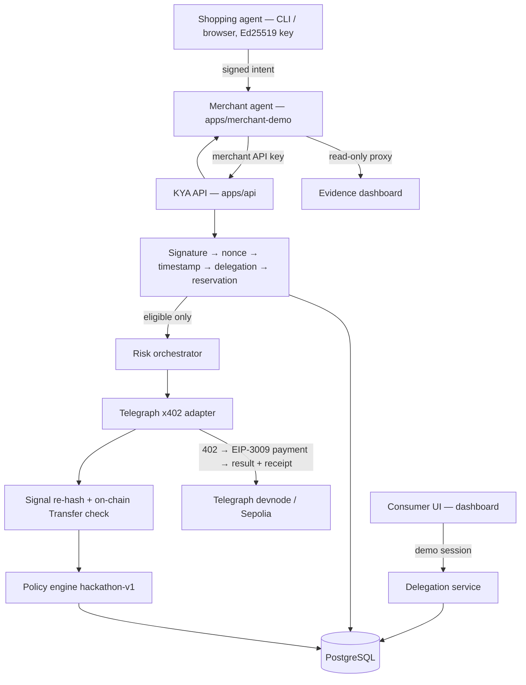

# Architecture

## Components

| Path | Role |
|---|---|
| `apps/api` | KYA HTTP service. Wires config → storage → issuer → intelligence client → service → HTTP. |
| `apps/merchant-demo` | The merchant agent. Quotes carts and computes `cart_digest` = sha256 of the canonical cart. It rejects intents that do not match its cart, calls KYA **automatically**, and completes a **simulated** checkout. It also proxies read-only evidence so the merchant key never reaches a browser. |
| `apps/shopping-agent` | CLI agent. Registers a key, obtains a delegation, signs intents and runs the PRD scenarios. |
| `apps/dashboard` | Preact + TypeScript + Vite. Scenarios, consumer delegation, checkout, evidence explorer, operations. |
| `apps/telegraph-probe` | Integration-spike tool: unpaid challenge probe, or `-pay` for one capped real purchase. |
| `sdk/typescript` | `@kya/sdk`: canonical JSON, `AgentSigner`, `KyaClient`, `KyaMerchantClient`, demo helpers. |
| `internal/canonical` | Deterministic JSON (JCS subset, integers only, rejects duplicate keys). |
| `internal/identity` | Ed25519 challenge, rotation and intent messages with domain separation. |
| `internal/delegation` | Issuer signing and the full delegation rule check (all failures reported). |
| `internal/policy` | Pure, versioned decision function. It cannot be configured to fail open. |
| `internal/telegraph` | `IntelligenceClient` interface, x402 client, EVM/EIP-712 signing, budget, simulated client. |
| `internal/service` | Orchestrates the pipeline and builds the trace, evidence document and audit event. |
| `internal/storage` | `Store` interface; PostgreSQL (source of truth) and in-memory implementations share one conformance suite. |
| `internal/evidence` | Evidence document hashing and the audit hash chain. |

## Verification pipeline (`service.Verify`)

1. **Schema.** Strict decoding: duplicate keys → 400, unknown fields → 422. Canonical RFC 3339 timestamps, `sha256:` cart digests, 16–128-character nonces, integer minor units.
2. **Merchant auth.** The bearer key resolves to a merchant. `merchant_id` in the body must equal it (403 otherwise: confused-deputy guard).
3. **Agent signature.** The key is looked up by `agent_id`. The signature must verify over `KYA-PURCHASE-INTENT-V1\n` + canonical payload. A disabled agent → DENY.
4. **Nonce.** An atomic insert into `purchase_intents`, unique on `(agent_id, nonce)` and on `intent_id`. A replay → 409 / `NONCE_REPLAY`. This runs only after the signature is valid, so third parties cannot burn an agent's nonces.
5. **Timestamp** within ±`KYA_CLOCK_SKEW_SECONDS`.
6. **Delegation.** Issuer signature (and that stored claims equal the signed bytes), issuer/audience, revocation, expiry, subject agent, merchant, action, category, currency, per-transaction amount. Every failure is reported.
7. **Cumulative reservation.** `SELECT … FOR UPDATE` on the delegation row, a sum of reservations, then an insert. Concurrent requests cannot overspend. Released on DENY.
8. **Telegraph purchase.** A `REQUESTED` row under a unique idempotency key, then the paid call, detached from client cancellation so a disconnect cannot orphan a payment.
9. **Receipt verification** → `SETTLED` or `UNVERIFIED`.
10. **Policy.** Hard failures → DENY. Unavailable, unverified, simulated (when not accepted) or uncalibrated → fail-closed decision. Otherwise the intent-specific level map and score thresholds apply, and the worse of the two wins.
11. **Finalize.** Hash the evidence document, persist the verification, append a hash-chained audit event and emit a structured log line.

## Data model

See `migrations/001_init.sql`. Beyond PRD §8, it adds:

- `agent_challenges`, so challenges are single-use: consumed with `DELETE … RETURNING`.
- `spend_reservations`, for cumulative limits.
- `delegations.signed_payload_text`, holding the exact signed bytes, because JSONB normalises whitespace and key order.
- `telegraph_requests.record` and `verification_decisions.document`, holding the full JSON records.
- An append-only trigger on `audit_events` that rejects UPDATE and DELETE.

## Modes

| | `local` | `competition` |
|---|---|---|
| Intelligence | simulated (default) or x402 | **x402 only** (refuses to start otherwise) |
| Simulated evidence can ALLOW | yes (`KYA_ACCEPT_SIMULATED`, labeled everywhere) | **never** |
| Storage | memory if no `DATABASE_URL` | **PostgreSQL required** |
| Secrets | generated ephemerally if unset | **required** |
| `X-KYA-Simulate` header | honoured by the simulated adapter | ignored |
